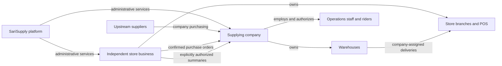

# SariSupply Canonical System Architecture

**Status:** Approved target architecture, following the user-approved architecture plan.
**Decision date:** 2026-10-06.
**Scope:** Business ownership, actors, permissions, application responsibilities, workflow ownership, and system invariants.

Read this document before planning, reviewing, or changing SariSupply. It defines
what the system must become. It does not establish that these capabilities are
implemented, deployed, or production-ready. The implementation gaps below are
part of this contract's context.

## 1. Authority and maintenance

Use the following requirement precedence:

1. Explicit current user requirements.
2. This canonical architecture for ownership, roles, business boundaries, and system invariants.
3. Approved milestone specifications consistent with this architecture.
4. Implementation plans and existing code.

[Current State](../engineering/CURRENT_STATE.md) records implementation status;
inspect code and verification evidence to establish actual behavior. Existing
implementation can reveal a gap but cannot redefine the approved architecture.
Older milestone specifications remain useful for compatible technical contracts.
Their conflicting business ownership or role assumptions are superseded here.
[design.md](../../design.md) remains the shared UI, UX, and copy contract; this
document does not authorize a visual redesign.

When an explicit user requirement changes this architecture, record the decision,
date, and affected sections here and align the affected specification. Identify
conflicts before implementation. Do not silently change the contract, give a
broader role to bypass missing permissions, or treat an architecture decision as
authorization to implement every outstanding feature.

## 2. Business model and ownership

SariSupply combines an offline-first retail POS with a distribution business.
The initial business structure is one supplying company serving independently
owned sari-sari stores. Multiple supplying companies and company-owned retail
stores are outside this baseline and require an explicit architecture decision.

| Term | Meaning and ownership |
| --- | --- |
| Platform | SariSupply's software and administrative services. Platform administration is distinct from operating the supplying company. |
| Company | The supplying business owned by the Company Owner. Owns warehouse inventory, warehouse staff, riders, wholesale operations, and company financial records. |
| Warehouse | A company-owned stock and fulfillment location. Its staff and riders receive explicit warehouse scope. It is not a customer store branch. |
| Independent store | A separately owned retail business and tenant. Owns its products, retail stock, sales, customers, staff, and POS records. |
| Store branch | An outlet belonging to one independent store business. Multiple branches of one store share that store's ownership boundary. |
| Upstream supplier | A vendor from whom the company purchases goods. A supplier directory record does not itself confer a login or permission. |
| Store customer | An independent store buying goods from the company. This commercial relationship is not company membership. |
| Rider | Company delivery personnel authorized for assigned warehouse work and delivery runs. |
| Retail customer | A person buying from an independent store. Retail customer records are distinct from the company's store customers. |

Company and store permissions must be resolved separately by the trusted server.
A supply relationship does not grant access to a store's staff, devices, retail
records, or other suppliers. Orders identify both businesses and their destination
branch; neither party gets unrestricted writes into the other party's tenant.

### Existing terminology

The current `merchantId` identifies the existing merchant business boundary;
`branchId` identifies an outlet within it. Current warehouse and delivery records
are also nested under that same merchant, which is an implementation gap for
independent-store distribution. A current `owner` membership is not automatically
a Company Owner, and a current `manager` membership is not automatically a
Warehouse Operations Manager. Likewise, `sarisupplyAdmin` identifies current
platform administration, not company employment.

Keep existing identifiers and APIs until a separately approved implementation
defines migration and compatibility. This document does not prescribe new
Firestore collection names or authorize relabeling existing stores as company
branches. Company selling products and store retail products require explicit
mapping of identity, units, and price; matching names or IDs alone is insufficient.

## 3. Actors, permissions, and applications

Roles belong to a business context. One human can hold several roles, but each
action must use the role and scope of the business it affects.

| Actor | Allowed responsibilities | Boundaries |
| --- | --- | --- |
| Company Owner | Review independent-store applications and approve or reject store onboarding; view company wholesale sales and finances; manage company purchasing, warehouses, stock, orders, staff, riders, deliveries, and reconciliation. Application review is limited to the submitted business and first-branch details. | Application approval grants only the applicant's Store Owner membership; it does not grant access to the store's retail records or control over its operations. Other independent-store access is limited to commercial records and explicitly shared summaries. |
| Warehouse Operations Manager | Process and accept store orders; receive company purchases; reserve stock; pick and pack; assign and monitor riders; receive returns; record collection and remittance reconciliation in assigned warehouses. | Cannot change company ownership, grant staff roles, invite riders, administer customer stores, or view unrelated warehouse records or company-wide finances. Staff management is not granted by default. |
| Rider | View assigned delivery runs and minimum destination/contact/package data; record progress, delivered and returned quantities, failure reasons, proof, and cash collected; explicitly share location for active assigned runs. | Cannot assign runs, change prices, approve orders, access unrelated deliveries, or administer warehouses or stores. |
| Store Owner | Manage the store's branches, team, devices, products, stock, retail sales, and finances; confirm supplier orders and receiving; control summary sharing. | Cannot enroll company riders, dispatch company deliveries, or access company internal finances and stock records. |
| Cashier | Use authorized POS checkout, payments, receipts, and shift operations, subject to existing approval policies. | Cannot manage company deliveries, consent to data sharing, grant roles, or approve supplier purchases. |
| Store Manager, optional | Perform explicitly delegated store operations within assigned branches under the existing store identity specification. | Does not acquire company operations permissions or Store Owner-only approvals. |
| Platform Admin | Review merchant onboarding through the separate platform workspace and perform authorized platform administration. | Is not a company or store membership and does not confer blanket access to retail records or company operational mutations. Company onboarding work belongs in the Company Owner workspace. |

The Company Owner may also hold Platform Admin authority. Warehouse employees
must receive their own scoped accounts rather than the owner's credentials or
platform privileges. A Store Owner who also runs checkout uses the appropriate
authorized POS session; role overlap does not remove actor attribution.

| Application | Target responsibility |
| --- | --- |
| Admin / Operations (`apps/admin`) | Company Owner and Warehouse Operations workspaces; separate Platform Admin workspace. Select and verify context before presenting privileged actions. Retain existing Android and Web support. |
| POS (`apps/pos`) | Independent-store management, retail inventory, purchasing from the company, receiving, and cashier checkout. Android phone/tablet and offline-first behavior remain. |
| Driver (`apps/driver`) | Rider enrollment acceptance and company-assigned delivery work on Android. |

These are target responsibilities. Moving existing POS dispatch to Company
Operations and separating Admin permissions are future implementation work.

## 4. Enrollment and access lifecycle

| Account or assignment | Authority and flow |
| --- | --- |
| Company Owner | Established through trusted administrative provisioning. No public self-elevation to company ownership. |
| Warehouse Operations Manager | Company Owner invites a verified Google-account email, selecting permitted warehouses. Recipient signs in and accepts a single-use, expiring invitation. |
| Rider | Company Owner invites a verified Google-account email and selects permitted warehouses. Rider signs into Driver and accepts; the backend connects the identity to the company roster. |
| Store Owner | A merchant application and supplying Company Owner approval establish the store business and its Owner membership; the separate Platform Admin review path remains available. |
| Store Manager | Store Owner invites the Google-account email and grants branch scope under the existing identity contract. |
| Cashier | Store Owner or an existing authorized store manager enrolls the cashier and branch assignments under the approved credential policy. Cashiers retain PIN access on registered, branch-scoped POS devices. |

Identity establishment, business membership, warehouse assignment, and delivery
assignment are separate operations. Signing in does not make a rider active.
Operations selects an active rider by name when assigning a run; riders and store
owners do not exchange internal account IDs. Warehouse Operations Managers may
dispatch existing riders but cannot create invitations or elevate roles by default.

The trusted server verifies invitation recipient, expiry, single-use acceptance,
current membership, and scope. Access removal prevents new server-authorized work
and is enforced on reconnect without deleting durable pending business evidence.
Retain the existing seven-day same-boot offline authorization limits; reboot or
missing clock evidence requires online recovery. New account enrollment and
privileged acceptance/dispatch require current online authorization.

## 5. Workflow ownership

Low-stock detection suggests purchases. The default is store-confirmed orders;
there is no automatic purchase commitment or company-initiated order acceptance
on the store's behalf.

| Stage | Responsible actor | Required result |
| --- | --- | --- |
| Suggest and confirm | Store Owner | Review suggested products and quantities; confirm a purchase to the company for a specific store branch. |
| Accept | Warehouse Operations Manager or Company Owner | Confirm stock, quantities, wholesale prices, and delivery arrangements. Material substitutions or changes to the store's confirmed purchase require store reconfirmation before fulfillment. |
| Reserve, pick, pack | Warehouse Operations Manager or Company Owner | Reserve company stock and prepare identifiable packages linked to the accepted order and destination. |
| Assign and dispatch | Warehouse Operations Manager or Company Owner | Select an active authorized rider, vehicle, packages, and stop sequence in the company workspace. |
| Deliver | Assigned Rider | Record actual quantities, rejection/return reasons, recipient proof, and cash collected. Partial or failed delivery remains explicit. |
| Receive | Store Owner, or Store Manager with explicit receiving permission | Confirm goods actually accepted into the store. Rider proof supports this process but does not silently settle disputed quantities. |
| Reconcile | Company operations and the authorized store recipient for their respective records | Resolve shortages/discrepancies, return receipt/disposition, payment evidence, and rider cash remittance. Company Owner retains financial oversight. |

Store Owners and explicitly authorized Store Managers can see their store's
orders and relevant delivery progress. They cannot choose or reassign the
company's rider. Cashier checkout access alone does not grant order-management
access. Rider completion, store receiving,
returned-goods receipt, and financial settlement are separate facts; a completed
route does not prove every order or payment is settled.

### Inventory and financial facts

- Company warehouse stock and store retail stock have separate owners and ledgers. Reservation does not increase store stock. At shipment, goods leave warehouse availability and are accounted for in transit; confirmed store receipt increases the receiving store's stock once.
- Packing and delivery evidence must not fabricate a store receipt. Partial receipt records actual quantities; unresolved items remain visible. Returns restore available warehouse stock only after authorized warehouse receipt and disposition; damaged goods can remain quarantined.
- Company wholesale sales differ from store retail sales. Company purchase cost, confirmed wholesale selling price, and store retail selling price are distinct facts. Order/package snapshots preserve agreed units and prices.
- Recording rider cash collection does not prove remittance to the company. Record and reconcile both. Delivery progress alone must not create a paid status. Cash and existing QR payments use manual confirmation under the approved payment contract.
- Preserve immutable financial facts and compensating entries, integer PHP centavos, atomic local stock/financial/outbox commits, stable operation IDs, and idempotent receiving/reconciliation. Future cross-business acceptance must converge after retries and partial acknowledgements without duplicate stock or payment effects.

## 6. Data sharing and reporting

Orders, delivery evidence, and payments between a store and the company are
commercial records available to the authorized parties. A company's upstream
costs, unrelated customer orders, and internal finances remain company records.
Detailed retail sales, receipts, customers, credit balances, and cashier records
remain store-controlled.

For replenishment, a Store Owner can explicitly authorize stock summaries and/or
sales summaries for the supplying company. Sharing is off by default, scoped to
the named company, data category, and replenishment purpose, and revocable by the
Store Owner. It grants summary reads only, not store administration or unrestricted
retail-record access. Warehouse managers see only summaries needed for their
assigned customer-order work; riders receive no replenishment insights.

The trusted server checks current consent on reads. Revocation stops future
summary access and refresh, and clients discard cached shared summaries when
revocation is observed. It does not erase legitimate order, delivery, payment,
or audit records. Reports disclose business, branch/warehouse scope, source,
and freshness; local-device records and unsynced summaries are not complete
business-wide totals.

## 7. Technical invariants and linked contracts

- All clients remain Flutter. Applications depend on focused shared packages; packages never import applications, and applications never import another application's source. See [Architecture Boundaries](../engineering/ARCHITECTURE_BOUNDARIES.md).
- Firebase Authentication establishes human identity; device identity and cashier business attribution remain separate. Domain policy stays independent of Firebase adapters. See the compatible contracts in the [identity specification](../superpowers/specs/2026-09-26-firebase-identity-tenant-auth-design.md).
- Firestore is the only cloud database. A trusted HTTPS backend performs privileged writes and checks current role, business, warehouse/branch, device, and resource assignment. Client IDs or claimed roles never establish authority. Client rules remain deny-by-default except deliberate authorized paths.
- Durable SQLite state and outboxes support offline retail and assigned delivery work. Preserve pending operations and reconcile conflicts explicitly. No client pretends an offline draft is an accepted purchase, reservation, membership grant, or dispatch.
- Keep Firebase Spark, Deno Deploy Free trusted computation subject to feasibility/capacity evidence, server-only secrets, and no paid fallback or second cloud database. See [Free Production Scope](../superpowers/specs/2026-10-04-free-production-platform.md).
- Retain existing inventory, cashier-credential, offline-credit, archive/retention, device-revocation, and audit contracts where compatible. Architecture alignment must preserve local data and pending financial operations through explicit migrations.
- Keep the agreed production acceptance gates, including full-platform completion before a real-world pilot. A documentation update, build, emulator pass, or demo does not establish production readiness. See the [Production Plan](SARI_SUPPLY_PRODUCTION_PLAN.md) and [Definition of Done](../engineering/DEFINITION_OF_DONE.md).

## 8. Current implementation gaps — 2026-10-06

These observations describe reviewed source, not live deployment acceptance.

| Area | Current implementation | Target correction |
| --- | --- | --- |
| Business boundary | [Restock and packing](../../firebase/functions/src/procurement/procurement-service.ts) use one merchant root and resolve destinations from its own branches. | Explicit company-to-independent-store orders, product mapping, and separately authorized ledgers/receiving. |
| Company staff | [Membership authorization](../../firebase/functions/src/common/authz.ts) recognizes merchant Owner/Manager; [dispatch](../../firebase/functions/src/delivery/delivery-service.ts) requires merchant Owner for management actions. | Company Owner and scoped Warehouse Operations authority without granting store Owner privileges. |
| Rider enrollment | [Driver entry](../../apps/driver/lib/app/driver_app_gate.dart) asks riders to share their account ID; [POS dispatch](../../apps/pos/lib/features/inventory/presentation/owner_dispatch_screen.dart) enrolls them manually. | Company-owned, email-bound invitations and roster selection. |
| Workspace | Warehouse fulfillment and dispatch are in POS; company operations are not separated completely from platform administration. | Company workflows in Admin / Operations; store workflows in POS; assigned delivery work in Driver. |
| Report visibility | [Operational reads](../../firebase/functions/src/management/operations-read-service.ts) allow Platform Admin to read merchant reports and require Owner membership for purchasing management. | Separate company authority and store-controlled summary consent; review existing broad reporting access during migration. |
| Store onboarding | Application review is exposed through the separate Platform Admin workspace. | Add routine review to the Company Owner's Admin / Operations workspace; trusted backend checks the current Company Owner role and grants only the approved applicant's Store Owner membership. Preserve the separate Platform Admin path. |

These gaps require separately scoped implementation, authorization review, and
data-preserving migration. No existing records, roles, routes, APIs, or access
controls changed when this document was adopted.

## 9. Decision record

| Date | Approved decision |
| --- | --- |
| 2026-10-06 | Initial structure: one supplying company and independent store businesses. |
| 2026-10-06 | Company sees commercial records and explicitly store-authorized replenishment summaries; detailed retail records remain store-controlled. |
| 2026-10-06 | Stores confirm purchases; company operations accepts, fulfills, and assigns riders. |
| 2026-10-06 | Adopt the documentation plan: canonical ownership/permissions, company rider invitations, distinct receiving and reconciliation, mandatory agent reads, and explicit implementation gaps. |
| 2026-10-07 | Add routine store application review and approval to the supplying Company Owner's Admin / Operations workspace; keep review data limited to the application packet and deny approval to Warehouse Operations and Store Owners. Preserve the separate Platform Admin review path. |
